# YY 翻译

把手机放在两个人中间，用各自的语言面对面交谈。

支持中文、英语、日语、韩语和法语，适用于 Android 8.0 及以上。

[下载 v1.0.0 安装包](https://github.com/peixiyeah/yy-translator/releases) · [安装与使用](#安装与使用)

## 对话接着聊，之前说过的随时看

双方各自看到自己语言的聊天气泡，新回复接在上一句下面。问路时聊到了下一个路口，还想确认刚才的出口号码，往回翻一下就能找到。点开任一气泡，可以放大阅读。

| 追加回复、点开旧消息 | 双方各自的聊天记录 |
| :---: | :---: |
| 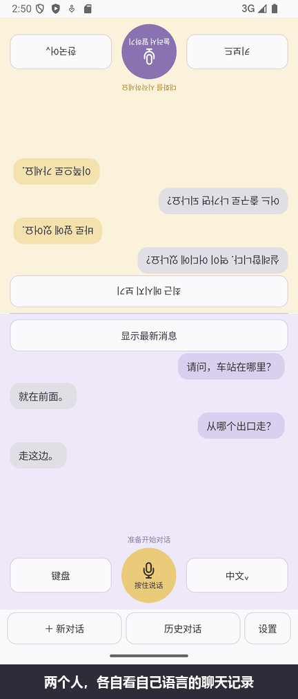 | 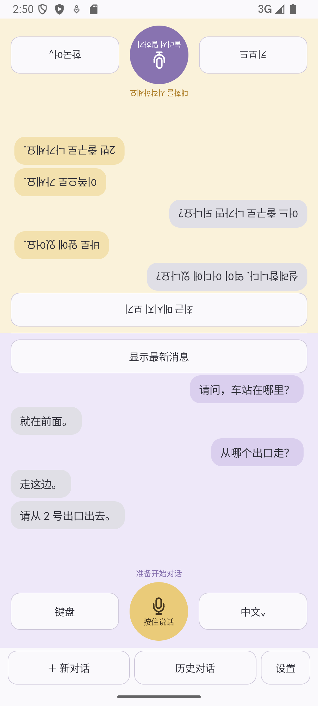 |

## 按住说话，松手等译文

上下两侧都有麦克风。按住时按钮放大、背景变暗，松手后双方都能看到自己语言的识别和翻译提示。译文出现时屏幕回亮，接收方可以开启自动朗读，也可以点「播放」重听。

| 从说话到译文出现 | 双方都能看见等待提示 |
| :---: | :---: |
| 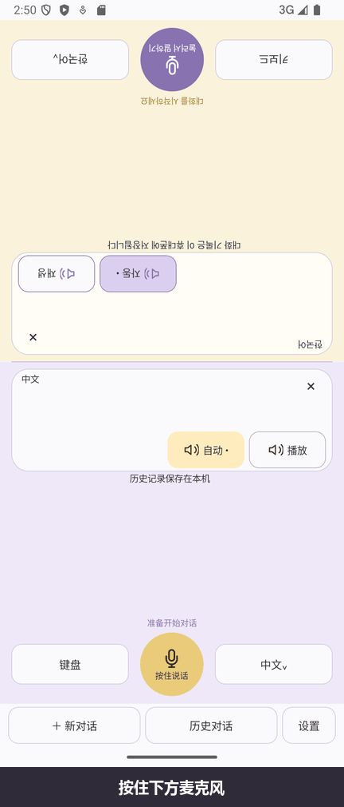 | 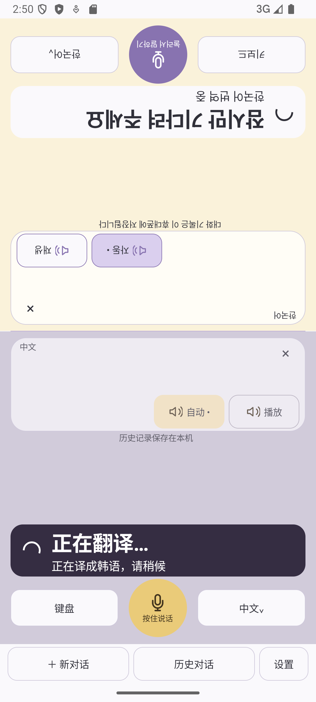 |

## 长句放大读，历史对话接着用

长译文会展开到状态提示上方，底部麦克风仍然可用。上下滑动读完内容，点 × 回到聊天。点「新对话」另起一段，之前的交流会保存到本机，可以随时找回继续。

| 阅读长译文，再回到聊天 | 展开后的大字译文 |
| :---: | :---: |
| 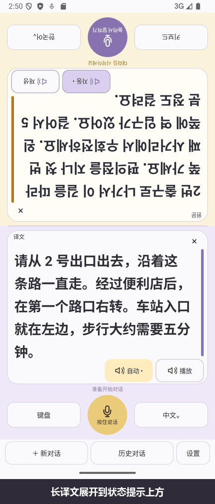 | 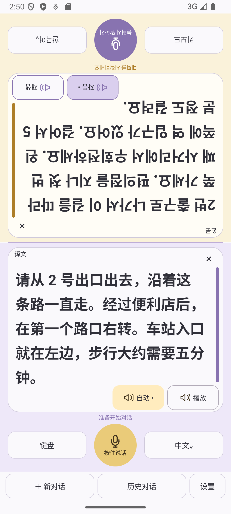 |

按首句、日期、语言和消息条数找到之前的对话，点进卡片即可继续交流。

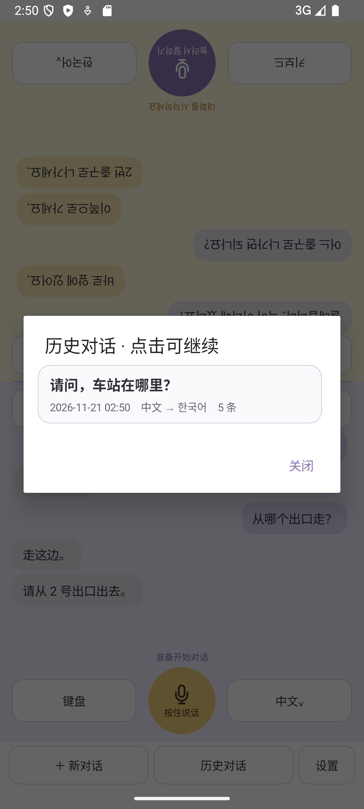

## 两侧都能输入，下方可用手机键盘

内置键盘朝向各自的使用者。下方输入区可以在「内置键盘」和「手机输入法」之间切换，已输入的文字会保留。选择手机输入法后，点输入框，就能用自己习惯的键盘继续打字。

| 内置键盘与手机输入法切换 | 切换时保留已输入的文字 |
| :---: | :---: |
| 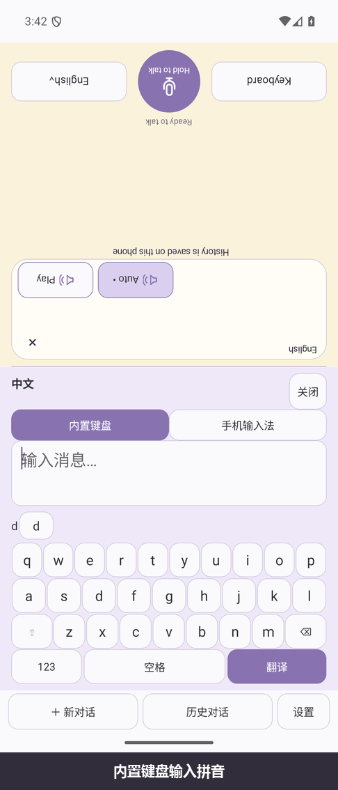 | 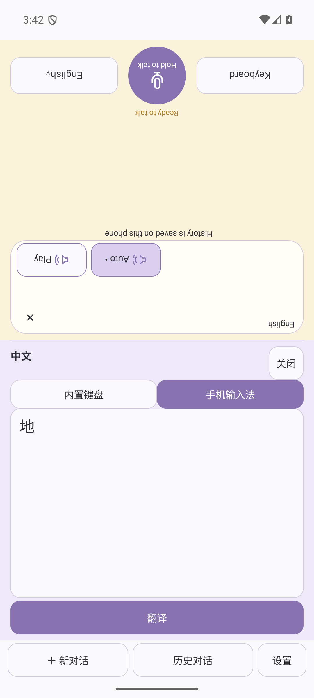 |

| 手机输入法打开后的完整界面 | 对面使用者看到的韩语键盘 |
| :---: | :---: |
| 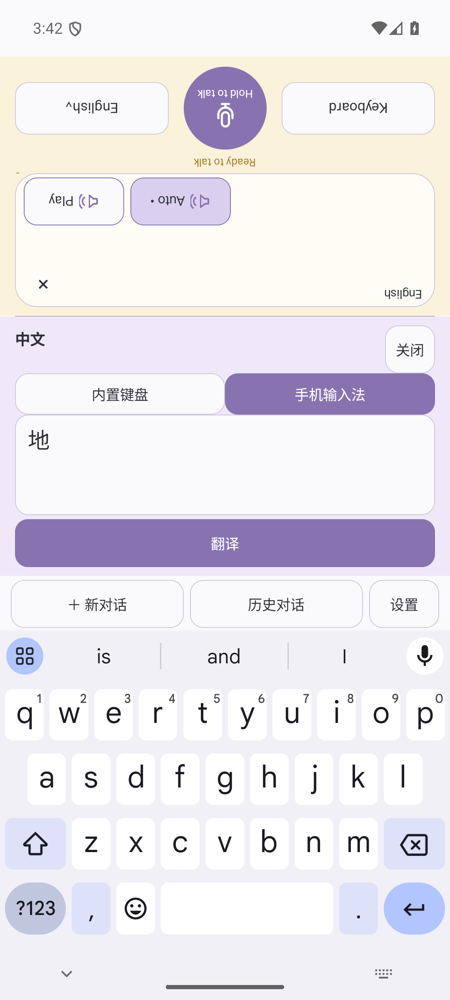 | 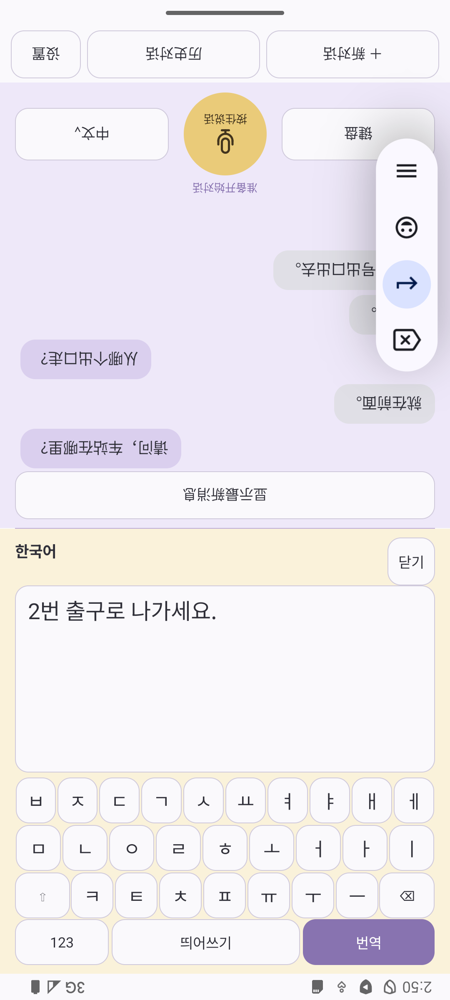 |

中日内置键盘提供离线候选选择和翻页。

| 中文内置键盘 | 日语内置键盘 |
| :---: | :---: |
| 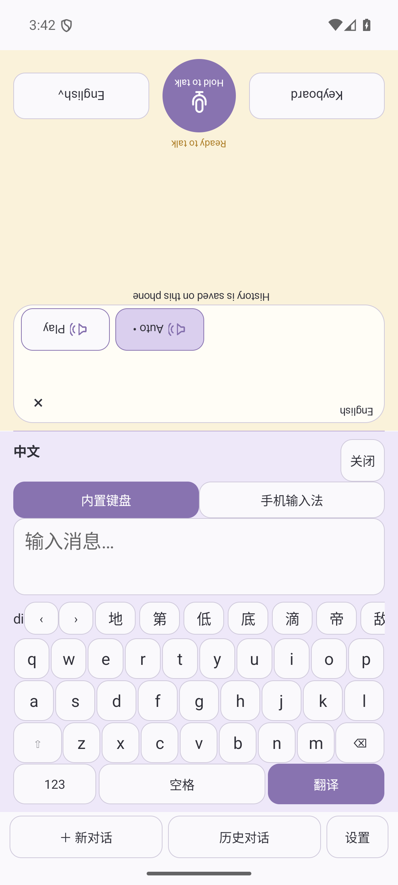 | 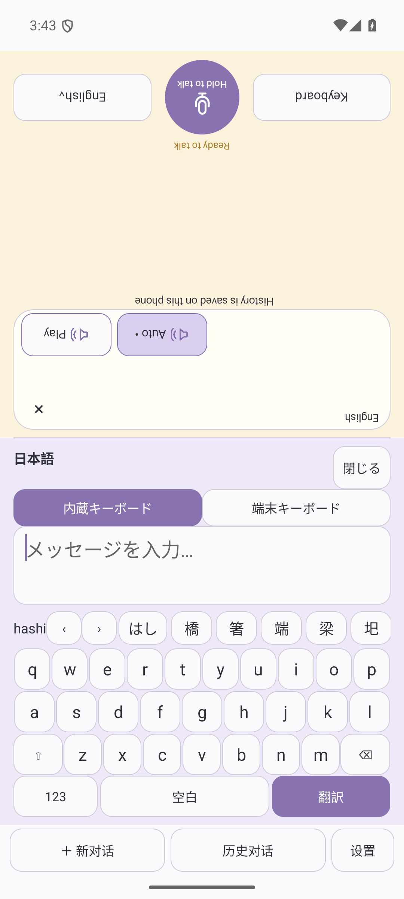 |

## 选择双方语言，随时交换方向

分别为上下两侧选择中文、英语、日语、韩语或法语，也可以一键交换双方语言。开始新的语言组合时，已有对话自动归档。

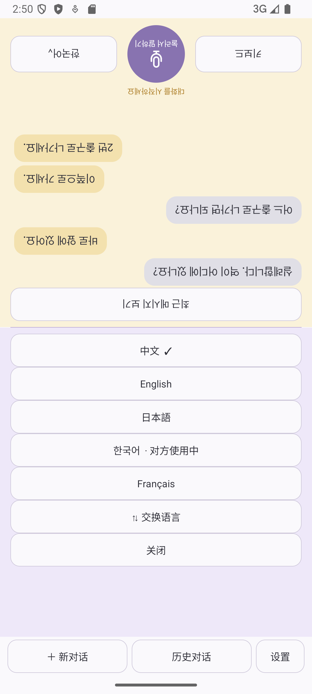

对话 GIF 使用预设问路内容展示交互流程，等待时间按演示节奏安排。键盘 GIF 取自模拟器实际操作。

## 安装与使用

1. 在仓库的 **Releases** 页面下载 `yy-translator-1.0.0.apk`，在 Android 8.0 或以上版本的手机上打开安装。已有安装的用户请选择「更新」，不要先卸载，以保留本机聊天记录。
2. 打开「设置」，填写自己的 **DeepSeek API Key**，再点「保存并测试当前语种对」。如需法语朗读，请同时配置阿里云百炼 API Key。
3. 回到对话页，分别选择双方使用的语言。第一次按住说话时，按系统提示允许使用麦克风。

## 数据与费用

聊天记录和加密后的 API Key 保存在手机本地。语音识别、翻译和朗读需要联网，相应的录音或文字会发送给配置的服务商。翻译时会附带最近最多六条对话作为上下文。API 用量计入自己的服务商账户。当前最多保留 50 段归档对话，卸载应用或清除数据会删除本机记录。

## 从源码运行

在 Android Studio 中打开项目，选择 `debug` 构建并运行。Windows 也可以在项目目录执行 `gradlew.bat assembleDebug`。开发版可以和正式版同时安装。

## 第三方材料与源码许可

YY 翻译的原创应用代码采用 [MIT License](LICENSE)，允许使用、修改、分发及商业使用，具体条件见许可证全文。

第三方组件和数据遵循各自的许可证，详见[第三方声明](THIRD_PARTY_NOTICES.md)。
